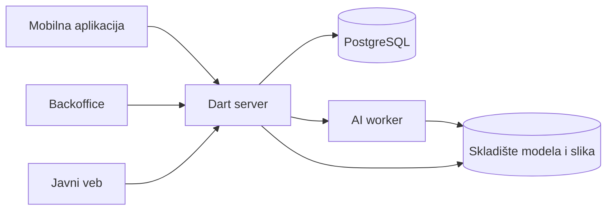

# tim-24
Hedrion 3D - Aplikacija za kreiranje i organizovanje 3D modela za video-igre pomoću veštačke inteligencije iz tekstualnih opisa ili slika, koja korisnicima omogućava upravljanje ličnom bibliotekom, pregled i preuzimanje modela, kao i deljenje modela u javnoj biblioteci nakon odobrenja moderatora.

# Hedrion

**AI studio za kreiranje, organizovanje i deljenje 3D modela za video-igre.**

Hedrion je multiplatformska aplikacija namenjena studentima i manjim timovima koji razvijaju igre. Korisnici kreiraju statične 3D rekvizite na osnovu referentnih slika ili tekstualnih opisa, čuvaju ih u privatnoj biblioteci, pregledaju i preuzimaju u GLB formatu. Za tekstualni unos planiran je postupak u dva koraka: generisanje referentne slike, pa pretvaranje slike u 3D model.

Korisnik može da predloži završeni model za javnu biblioteku. Moderator proverava prijavu i odlučuje o objavljivanju, a odobreni modeli dostupni su svima na javnom vebu. **Lična biblioteka je osnovna namena aplikacije; javno deljenje je opciono.** Početni fokus su statični rekviziti, poput sanduka, nameštaja i kamenja.


## Tim

| Ime i prezime | Broj indeksa | GitHub nalog |
|---|---|---|
| Vasilije Stankovic | SI 100/24 | [Vaske10024](https://github.com/Vaske10024) |
| Jovan Petrovic | SI 115/24 | [jpetrovic115si](https://github.com/jpetrovic115si) |

## Obrazloženje zahteva za temu

1. **Uloge.** Kreator putem mobilne aplikacije kreira i uređuje svoje privatne 3D modele i predlaže završene modele za javnu biblioteku. Moderator u backoffice aplikaciji pregleda prijavljene modele i ima ovlašćenje da odobri ili odbije njihovo objavljivanje.

2. **Stanja.** Glavni pojam sistema je **3D model (`Asset`)**, koji prolazi kroz stanja `draft` (nacrt), `queued` (u redu za generisanje), `generating` (generisanje), `ready` (spreman), `pendingReview` (na moderatorskoj proveri) i `published` (objavljen), uz stanja `failed` (neuspela generacija) i `rejected` (odbijena javna prijava). Objavljivanje je opciono, pa model može trajno da ostane privatan u stanju `ready`; dozvoljeni prelazi proveravaju se u zajedničkom domenskom paketu.

3. **Pravila.** Naziv modela mora imati od 3 do 60 znakova nakon uklanjanja početnih i završnih razmaka, a samo vlasnik završenog modela sa dostupnim izlaznim fajlom može da ga pošalje na moderatorsku proveru. Radi ograničavanja troškova, sistem ima **zajedničku dnevnu kvotu od 20 prihvaćenih zahteva za generisanje za sve korisnike**, pa server odbija upis novog zahteva ako su raniji zahtevi korisnika već popunili kvotu.

4. **Rad bez mreže.** Korisnik može bez internet veze da promeni naziv ili opis sopstvenog modela čiji su podaci već sačuvani u lokalnoj biblioteci. Izmene se trajno pamte na uređaju i sinhronizuju po povratku veze, uz obaveštenje o eventualnom konfliktu; samo AI generisanje zahteva internet vezu.

5. **Posao za osoblje.** Moderator obrađuje veći broj prijava kroz tabelu sa pretragom, filterima, statusima i detaljima izabranog modela u bočnom panelu, za šta je potreban veći ekran. Za svaku prijavu može da odobri objavljivanje ili da ga odbije uz obrazloženje, a rad tastaturom olakšava obradu većeg broja zapisa.

6. **Javni sadržaj.** Javna biblioteka bez prijave prikazuje samo odobrene i objavljene modele, sa zasebnim stranicama koje sadrže naziv, opis, kategoriju, sliku pregleda i izabranu licencu. Stranice isporučuju sadržaj kao HTML pogodan za indeksiranje u pretraživačima, a preuzimanje modela omogućeno je kada ga autor dozvoli.

### Primer pravila koje zavisi od drugih korisnika

Ako je Vasilije danas poslao 12 prihvaćenih zahteva, a Jovan 8, zajednička kvota od 20 je popunjena. Server odbija sledeći zahtev bilo kog korisnika porukom „Dnevna kvota za generisanje je popunjena“ i ne upisuje novi posao obrade niti menja stanje modela u `queued`, čak i ako je GPU trenutno slobodan. Korisnikov nacrt ili prethodno neuspešan model ostaje sačuvan, pa novi pokušaj može da pošalje kada počne naredni dan.

Dan se računa od 00:00 do narednih 00:00 po UTC vremenu servera. Svaki prihvaćeni zahtev, uključujući ponovni pokušaj generisanja, zauzima jedno mesto u dnevnoj kvoti bez obzira na kasniji ishod; ponovno slanje istog zahteva ne troši dodatno mesto. Odbijeni zahtevi ne ulaze u red čekanja i ne prihvataju se automatski narednog dana.

## Glavni tok rada

1. Kreator pravi nacrt modela, bira referentnu sliku ili unosi tekstualni opis i dopunjava podatke o modelu.
2. Server proverava domenska pravila i broj već prihvaćenih zahteva svih korisnika za tekući dan. Ako je kvota popunjena, odbija novi zahtev i model zadržava prethodno stanje.
3. Prihvaćeni zahtev ulazi u red čekanja, a generisanje počinje kada postoji slobodan GPU kapacitet.
4. Nakon uspešne obrade model je spreman za pregled i preuzimanje u privatnoj biblioteci.
5. Kreator po želji šalje završeni model na pregled za javnu biblioteku.
6. Moderator odobrava ili odbija prijavu uz razlog. Samo odobreni model postaje javno dostupan.

Osnovni tok stanja:

```text
draft -> queued -> generating -> ready -> pendingReview -> published
generating -> failed -> queued
pendingReview -> rejected -> ready
```

Ponovni pokušaj generisanja pravi novi posao obrade. Odbijanje javne prijave ne briše uspešno generisani privatni model; posle dorade podataka kreator može ponovo da ga pošalje na pregled. Javna prijava vezuje se za konkretan generisani rezultat, tako da kasnije privatne izmene ne menjaju automatski već odobreni javni sadržaj.

## Delovi sistema

| Deo | Korisnici | Planirana tehnologija | Platforme |
|---|---|---|---|
| Mobilna aplikacija | Kreatori modela | Flutter | Android |
| Backoffice | Moderatori | Flutter | Windows i veb |
| Javni veb | Svi posetioci, bez prijave | Jaspr u Dartu | Pregledač |
| Server | Mobilna aplikacija, backoffice i javni veb | Dart i PostgreSQL | Linux |
| Domenski paket | Sva četiri dela sistema | Dart | Sve platforme sistema |

Sva četiri dela koriste **isti domenski kod u Dartu** iz paketa `packages/domain`, sa modelima, validatorima i pravilima prelaska između stanja. Server čuva podatke, ponovo proverava sva pravila i konačno odlučuje o prihvatanju novog zahteva na osnovu svežih podataka svih korisnika. Proveru dnevne kvote i upis prihvaćenog zahteva izvršava atomski, tako da dva istovremena zahteva ne mogu da zauzmu poslednje preostalo mesto.

Flutter klijenti dodatno dele čist Dart paket `packages/blocs`, sa Bloc događajima i Equatable stanjima. Zajednički paketi biće organizovani kroz Pub workspace u korenu repozitorijuma.

Poseban Python AI worker na cloud GPU infrastrukturi obavlja generisanje geometrije i tekstura. Dart server upravlja zahtevima, proverava prava i kapacitet, a modeli i slike čuvaju se u skladištu fajlova.



